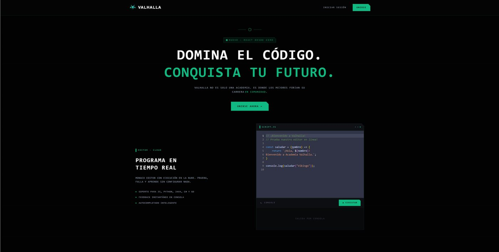
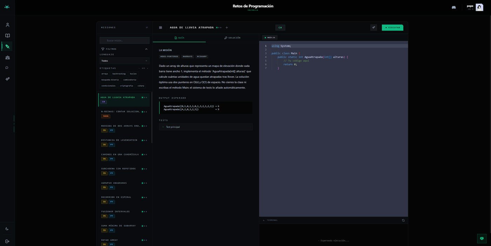
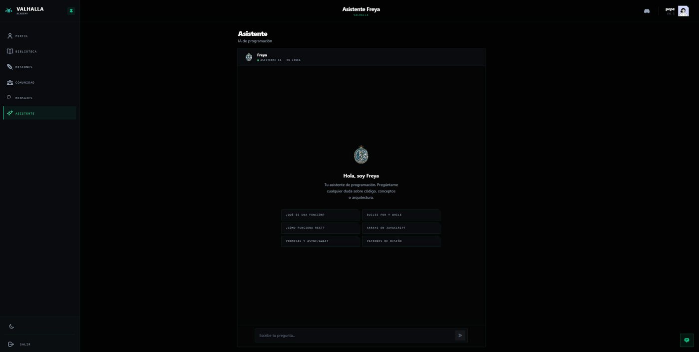
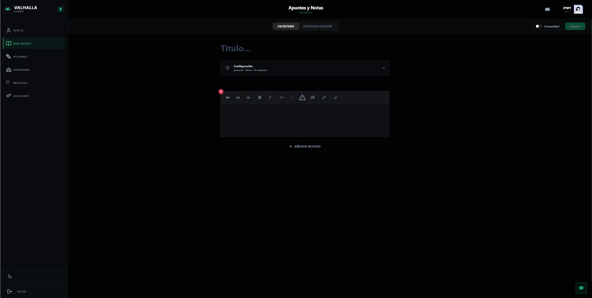
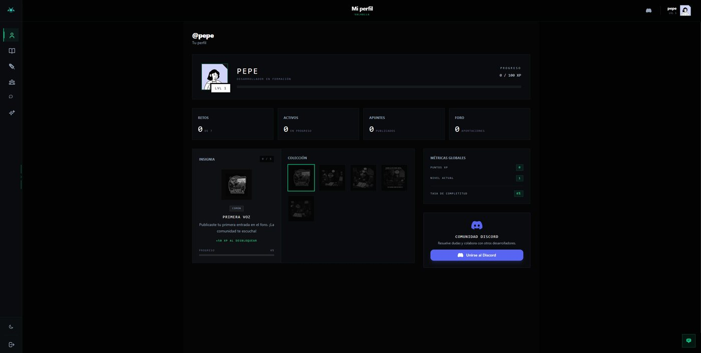

<h1 align="center">Academia Valhalla</h1>

<p align="center">
  <b>Aprende a programar, practica con retos y crece en comunidad.</b><br>
  Plataforma full-stack con editor de código, tiempo real y asistente de IA · <i>Proyecto Fin de Ciclo (DAM)</i>
</p>

<p align="center">
  <a href="https://academia-valhalla-puce.vercel.app"><b>🌐 Demo</b></a> ·
  <a href="https://valhalla-back.onrender.com/api/docs"><b>📘 Swagger UI</b></a> ·
  <a href="#-capturas">Capturas</a> ·
  <a href="./DESARROLLO_LOCAL.md">Arranque local</a>
</p>

<p align="center">
  
  
  
  
  
  
  
  
  
  
  
  
  
</p>

<p align="center">
  
</p>

> La demo corre en servicios gratuitos: algunas funciones, como la ejecución de código, pueden ir ralentizadas, y el backend (Render) tarda en despertar tras un rato sin uso.

## ✨ Qué hace

| | |
|---|---|
| 💻 **Editor de código** | Editor **Monaco** integrado en el navegador con ejecución de código en la nube (Judge0) y retos con tests automáticos |
| 🧊 **Contenido interactivo** | Escenas 3D con **Three.js** y animaciones con GSAP |
| ⚡ **Tiempo real** | **Socket.IO**: mensajería directa y de grupo (con imágenes, audio y vídeo), notificaciones y estados de conexión |
| 🤖 **Asistente con IA** | Chatbot **Freya**, con **Groq SDK**, para resolver dudas de programación |
| 🔐 **Autenticación** | Registro e inicio de sesión local, **OAuth con Google y GitHub** (Passport) y **JWT**; recuperación de contraseña por correo |
| 🏅 **Gamificación** | XP, niveles, logros y rachas; retos por dificultad y categoría |
| 🗣️ **Comunidad** | Foro con publicaciones, votaciones y moderación; además, torneos, mentorías y un *showcase* de proyectos |
| 📝 **Notas de estudio** | Editor de bloques de contenido con imágenes (Supabase Storage) |
| 🛡️ **Administración** | Panel para gestionar contenido, usuarios y analíticas |

## 📸 Capturas

<table>
<tr><td align="center"><br><sub><b>Retos de programación con editor</b></sub></td><td align="center"><br><sub><b>Asistente de IA</b></sub></td></tr>
<tr><td align="center"><br><sub><b>Apuntes y notas</b></sub></td><td align="center"><br><sub><b>Perfil, XP y logros</b></sub></td></tr>
</table>

## 🏗️ Arquitectura

```
┌──────────────────────┐   REST + JWT    ┌────────────────────────┐        ┌────────────┐
│  front (Vercel)      │ ──────────────► │  back (Render)         │ ─────► │ PostgreSQL │
│  React 19 + Vite     │ ◄────────────── │  Express 5 + Sequelize │        └────────────┘
│  Monaco · Three.js   │   Socket.IO     │  Passport · Swagger    │ ─────► Supabase Storage
└──────────────────────┘                 └────────────────────────┘ ─────► Groq · Judge0
```

| Capa | Tecnologías |
|---|---|
| Frontend | React 19, TypeScript, Vite, Tailwind CSS, GSAP, Three.js, Monaco Editor, React Router, React Hook Form, Socket.IO (cliente) |
| Backend | Node.js, Express 5, TypeScript, Sequelize + PostgreSQL, Passport (Google / GitHub), JWT, bcrypt, Socket.IO, Nodemailer, Multer |
| Servicios | Groq (IA) · Judge0 (ejecución de código) · Supabase Storage (archivos) |
| Documentación | Swagger / OpenAPI en `/api/docs` |
| Infraestructura | Docker Compose (PostgreSQL en local) · Vercel (front) · Render (back) |

## 🚀 Arranque rápido (local)
> Guía completa en [`DESARROLLO_LOCAL.md`](./DESARROLLO_LOCAL.md).

```bash
# 1. Base de datos
docker compose up -d

# 2. Backend (http://localhost:3000)
cd back
npm install
# crea back/.env con las variables de DESARROLLO_LOCAL.md
npm run dev

# 3. Frontend (http://localhost:5173)
cd ../front
npm install
npm run dev
```

Requisitos: Node.js 20+, Docker Desktop y Git. Nunca subas tus `.env`: contienen claves OAuth, JWT, credenciales de correo y keys de Supabase.

## 📁 Estructura
```
AcademiaValhalla/
├── front/src/app/
│   ├── features/       # admin, asistente, auth, community, home, messaging, notes, retos, settings…
│   ├── context/        # Tema, usuario, mensajería, logros
│   ├── hooks/ · services/ · components/
├── back/src/
│   ├── rutas/ · controladores/ · servicios/   # API por módulos
│   ├── modelos/        # Modelos Sequelize
│   ├── config/         # BD, Passport, Supabase
│   └── scripts/        # Seeds y migraciones
├── docker-compose.yml
└── docs/screenshots/   # Capturas de pantalla
```

---
<p align="center">Proyecto Fin de Ciclo de <a href="https://github.com/Alejandro-Plata">Alejandro Plata Cortés</a> · Técnico Superior en Desarrollo de Aplicaciones Multiplataforma</p>
